# Khabar by [Team Name]

> **Apa khabar? · 你好吗? · நலமா?**
> AI aftercare for Malaysian clinics. Patients understand their treatment in their own language, and the clinic knows who is slipping before they end up back in the queue.

**Team:** [Your Name] (solo)
**Problem Statement:** Self-defined, SDG 3 (Good Health and Well-being): patients lose track of their treatment once they leave the clinic.
**Video Presentation:** [Unlisted YouTube link: to be added after recording]
**Presentation Slides:** [Public link: to be added]
**UI Prototype (live):** [khabar-landing-six.vercel.app](https://khabar-landing-six.vercel.app), a working app, not a mock-up. Press **Open the demo clinic** on the landing page (or **Doctor view** / **Patient view** on the sign-in page) to explore with fictional data.
**API reference (live):** [khabar-api.vercel.app/docs](https://khabar-api.vercel.app/docs)
**Code:** [github.com/tanhongsheng050204-code/KHABAR-HEALTHCARE](https://github.com/tanhongsheng050204-code/KHABAR-HEALTHCARE)

[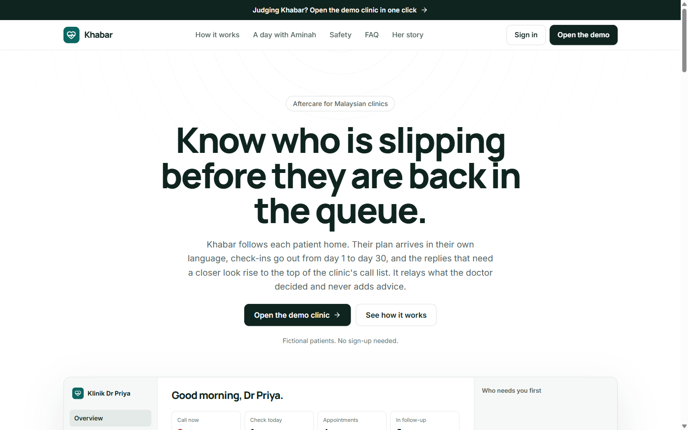](https://khabar-landing-six.vercel.app)

> ⚠️ **Status (18 Oct 2026):** working prototype, deployed.
> - **Landing page:** on 18 Oct the web app moved to a quieter "ledger" look (one ink, one teal accent, thin grid lines; Manrope headings, Inter text). `/` is now a product page that replays the clinic's own screens and opens the demo clinic in one click. The storybook film of Aminah's 30 days moved to `/story`.
> - **Web checks (18 Oct):** 226 browser tests on desktop and phone layouts (36 layout-specific skips), 49 unit tests, lint and type checks all passed. Lighthouse mobile performance: `/` 93–97, `/login` 96, `/story` 86–88 (the live film scored 82–85 on the same machine that day; the 94–95 of 1 Oct was measured on a quieter machine).
> - **Also new on 19 Oct (second round; needs the same API redeploy):** condition pathways, 30-day trends and lab results, a visible follow-up risk score, Ask Khabar, nurse call scripts, a visit pre-brief, a meal-photo check that only quotes clinic diet tips, voice replies, a simple big-button screen, family Telegram groups, caregivers acting for the patient, a workload board, a monthly outcomes report, CSV patient import and a pricing page with a value calculator.
> - **New on 19 Oct (the API needs a manual redeploy before they appear on the live site):** dose, refill and appointment reminders on Telegram with Taken / Missed buttons, no-show follow-up, caregiver alerts on Telegram, English glosses of replies for staff, a plan check for patients, an end-of-shift handover, and concept rules that catch more emergency wording. See [New in October 2026](#new-in-october-2026).
> - **New on 18 Oct (in the code; the API needs a manual redeploy before they appear on the live site):** counts-only staff alerts and a morning briefing to a clinic's Telegram group, an independent check that holds a take-home plan whose medicines or numbers do not match the prescription, "What the AI saw" receipts, a tamper-evident (hash-chained, daily-anchored) access log, a one-gentle-re-ask no-reply sequence, a clinic impact panel, case notes with @mentions, PDPA export/erasure/correction requests and a breach register, voice notes and packet photos through Telegram, and the patient and caregiver screens in BM, 中文 and தமிழ். See [New in October 2026](#new-in-october-2026).
> - **Agent tests:** 278 passed on 19 Oct.
> - **API tests:** 19 Oct: 324 tests, 0 failures, 1 optional PostgreSQL test skipped. Web: 226 browser tests and 53 unit tests passed.
> - **Deployment:** the web app deploys automatically on every push to `main`. The API and agents are deployed manually.
>
> All patient data is **fictional**. Khabar is **not a medical device** and is not for clinical use. Full plan: [plan.md](plan.md). Open work: [UNDONE_WORK.md](UNDONE_WORK.md).

---

## Contents
1. [Project Overview](#1-project-overview)
2. [Ideation & Process](#2-ideation--process)
3. [Design & Prototype](#3-design--prototype)
4. [What Makes It Different](#4-what-makes-it-different)
5. [Technical Architecture & Feasibility](#5-technical-architecture--feasibility)
6. [Evidence it works](#6-evidence-it-works)
7. [Run it yourself](#7-run-it-yourself)
8. [Credits & Declarations](#8-credits--declarations)

---

## 1. Project Overview

### The Problem
Malaysian clinic patients leave with instructions they often can't follow, and nobody checks on them until something goes wrong. The typical result is a patient like **Mak Cik Aminah**, 64, who takes metformin from the klinik kesihatan *and* the same drug under a different brand name from her GP, adds bitter-gourd juice her sister recommended, and returns to emergency with low blood sugar. No one ever saw all three together.

**Causes, as we understand them**

| Cause | Why it matters |
|---|---|
| **No time to explain** | Doctors in understaffed public clinics see 80–100 patients a day. A rushed explanation is quickly forgotten. |
| **Instructions people can't use** | Summaries and prescriptions come in English clinical jargon, while **35% of Malaysian adults** have limited health literacy (NHMS 2019), most of them older adults. |
| **Nobody follows up** | Medication adherence among chronic-disease patients is around **50%**, and only **34%** for type 2 diabetes. Problems surface only at the next visit, or in emergency. |
| **Fragmented care** | There is no shared record across GP, klinik kesihatan and specialist, so medicines are never cross-checked. **46%** of urban older adults take many medicines at once. |
| **Hidden traditional medicine** | **69.4%** of Malaysians use traditional or complementary medicine, and patients often don't tell their doctor. |
| **Families carry the care, uninformed** | **79.6%** of older Malaysians depend on their children, who are rarely kept in the loop. |

**Stakeholders**
- **Patients:** especially older, multilingual and chronically ill people managing several medicines.
- **Family caregivers:** adult children who help with medicines and appointments.
- **Clinic doctors and staff** at private GP clinics and public klinik kesihatan: they need to know *who* to call, not read every message.
- **Clinic owners:** they carry the cost of repeat visits, no-shows and patients who drift away.
- **The wider system:** avoidable emergency admissions for complications like hypoglycaemia.

**What already exists, and why it falls short**

| Existing solution | What it does | Where it falls short |
|---|---|---|
| **CliniFlow AI** (UM Hackathon 2026 champion) | End-to-end clinic workflow: AI intake, AI report drafting with safety checks, a patient summary on WhatsApp | Stops at one WhatsApp message after the visit. The summary appears to be English only. No follow-up afterwards. |
| **Memora Health** (US, now part of Commure) | AI text-message follow-up after discharge, escalating to nurses | Built for US hospital systems over English SMS. Not available for Malaysian clinics, WhatsApp, or BM, Chinese and Tamil. |
| **PULIH by AstraZeneca** (Malaysia) | Patient-support app with medication reminders | Tied to one company's support programme. No follow-up by the clinic and no alerts to the clinic. |
| **DoctorOnCall / BookDoc** (Malaysia) | Online consultations, pharmacy, booking | Focused on *getting* care, not on what happens after the patient goes home. |

### Our Solution
Khabar is an AI platform for Malaysian clinics that follows the patient home. It keeps the clinic workflow CliniFlow showed works (AI intake, a structured report draft from the doctor's notes and a hard safety gate), then makes the **30 days after the visit** the main story: a plain-language summary in the patient's own language, regular check-ins with prototype reply routing into a daily clinic review list. Khabar never gives new medical advice. It relays what the doctor decided; replies needing review enter the clinic queue, but staff are not automatically notified and anyone's response is not guaranteed.

**Feature set**

| Stage | Features |
|---|---|
| **Before the visit** | Self-booking from the clinic's calendar · a guided intake chat in the patient's language that already knows their history · a pre-visit page for the doctor · a shared **"everything I take"** list (medicines from every clinic, supplements, jamu, herbs) · reading a **medicine-packet photo**, with consent, into that list |
| **During the visit** | The doctor types shorthand or speaks, and deterministic parsing structures those clinician-authored notes into a draft report · a **safety check** (allergy, interaction, duplicate across clinics and brands, herb clash, dose, pregnancy, invented drugs or symptoms, missing fields) · a **critical finding cannot be finalised** without a written reason, enforced in the screen, the API **and** the database |
| **After the visit** | A summary in **BM, English, Chinese or Tamil**, sent on Telegram · **Ramadan fasting mode** (sahur and berbuka timings) · **caregiver access** that the patient grants and can revoke |
| **Follow-up, days 1–30** | Check-ins on days 1, 3, 7, 14 and 30 · prototype reply routing in four languages · precautionary 999 wording for replies needing review · home blood pressure and glucose readings (manual, or a Favoriot-linked device) · the clinic's **"who needs you first"** call list |
| **Privacy** | Access rules per role · encrypted sensitive fields · the patient's registered name, IC and phone numbers removed before text reaches the AI (other names typed in free text are not detected, so patients are asked not to type them) · a **"who viewed my record"** audit trail |

---

## 2. Ideation & Process

### 2.1 Ideas We Considered
Chosen ideas are listed first.

| Idea | Why it was kept / dropped |
|---|---|
| **A (Chosen)** Clinic workflow with "after the visit" as the main story | Market research found the spaces before and during the visit crowded (scribes, booking, telemedicine), but almost nobody follows the patient home in Malaysia. |
| **B (Chosen)** Summaries in BM, English, Chinese and Tamil | Plain-language rewrites improve understanding, and Malaysia is multilingual. AI translation still lags for non-English languages, so wording is constrained to what the doctor approved. |
| **C (Chosen)** Two-way follow-up with clinic review routing | Adherence is about 50%. A chat app on the patient's own phone keeps follow-up where they already are (Telegram for now; see Messaging below). Memora proved the model in the US. Reply routing is a prototype and does not provide staff alerts or validated emergency detection. |
| **D (Chosen)** "Who needs you first" call list for the clinic | Gives the paying customer, the clinic, a daily reason to open the product. |
| **E (Chosen)** "Everything I take" list and packet photo | Fragmented records plus 69.4% traditional-medicine use means duplicates and herb clashes go unseen. |
| **F (Chosen)** Family caregiver access, with consent | 79.6% of older Malaysians rely on their children. |
| **G (Chosen)** Ramadan fasting mode | About 90% of Malaysians with type 2 diabetes fast, and low-blood-sugar risk rises. |
| **H (Chosen)** Layered privacy and "who viewed my record" | Health data is sensitive personal data under the PDPA. A visible audit trail builds trust. |
| **I (Chosen)** Malaysian brand-name to generic mapping | Patients hold packets with local brand names, while interaction data uses generic names. |
| **J (Chosen)** Patient graph in Neo4j (de-identified) | "Which drug, from which clinic, clashes with which herb" is a multi-step question that a graph answers naturally. |
| **K (Chosen, stretch)** Home readings via Favoriot IoT | Useful for chronic follow-up. Built, but shown with simulated readings until a real device is tested. |
| **L (Chosen, stretch, not built)** Voice-note summaries | Helps low-literacy and low-vision patients. First to drop if time runs out. |
| **M (Chosen, stretch, not built)** Learning each doctor's writing style | Nice-to-have. First in the drop order. |
| N. AI scribe as the main product | The most crowded category in health AI. Kept only as a supporting step in the visit. |
| O. Generic symptom-checker chatbot | Crowded (Ada, K Health), and risks giving medical advice. |
| P. Mental-health chatbot | Crowded (Naluri, Wysa) and under regulatory scrutiny. |
| Q. X-ray or image diagnosis model | A regulated medical device (MDA), and impossible to validate in a hackathon. |
| R. Admin and insurance paperwork automation | Needs real documents and integrations. Weaker patient-impact story. |
| S. Standalone caregiver app / triage tool / document explainer | Merged into Khabar as F, the intake chat and B. |
| T. Straight rebuild of CliniFlow | No identity of its own. We borrowed its patterns and changed the main story instead. |
| U. True end-to-end encryption (only the patient's code unlocks data) | Would break the agents, safety checks and follow-ups, and a lost code means a lost history. Replaced by H. |
| V. Let the AI judge drug interactions | An AI checking an AI with no ground truth. We use the DDInter database and written rules instead. |
| W. DeepSeek or Qwen as the main LLM | Data would leave for China, a PDPA question in a health product. |
| X. Qwen3-ASR or Voxtral for transcription | Neither supports Malay or Tamil. |
| Y. WhatsApp links that open a pre-filled chat | Can't automate a 30-day follow-up. |
| Z. SMS login codes | Needs a paid SMS provider. Email codes are free and anyone can test them. |
| AA. Native mobile app | App-store friction. A web app that installs on phones gives the same result. |
| AB. Names "Pulih" and "Nalam" | Already used by existing health apps. "Khabar" comes from *apa khabar?* ("how are you?"), which is exactly what the product asks. |

### 2.2 Ideation Boards

**Problem tree:** what goes wrong once a patient leaves the clinic.
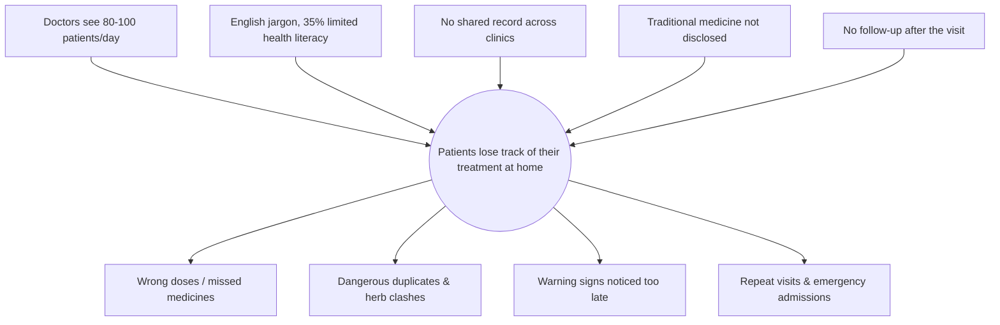
*Five root causes lead to one core problem. Each Khabar feature answers one of the causes.*

**5 Whys:** why did Mak Cik Aminah end up back in emergency?
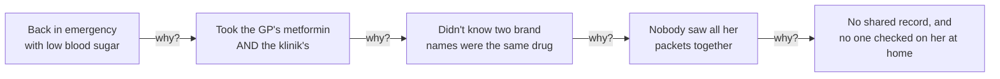
*This chain produced two features: the "everything I take" list with the cross-clinic duplicate check, and the 30-day follow-up.*

**Idea map:** how market gaps became Khabar.
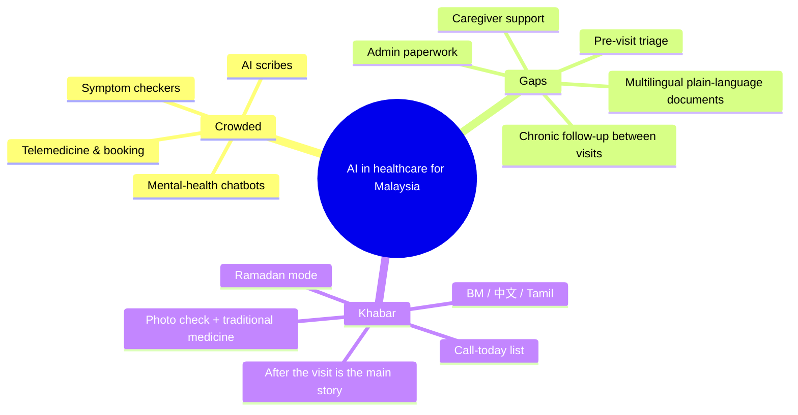
*We sorted health-AI ideas into crowded and underserved, then merged four of the gaps into one product.*

**User flow:** one patient's journey, and where a human always stays in charge.
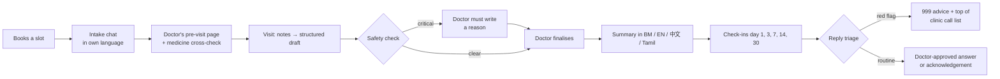
*The software prepares drafts and sorts follow-up. The doctor decides every clinical point. Replies needing review enter the clinic queue, but no staff notification is sent and the prototype is not a reliable emergency screen.*

**Design evolution:** the UI went through three rounds before the current one.

| Round | What it was | What we learned |
|---|---|---|
| 1. Single-page prototype ([prototype/khabar-landing.html](prototype/khabar-landing.html)) | Interactive story: language switch, medicine scan, reply triage, safety gate | The story lands best told through one patient (Aminah) |
| 2. Static screens ([docs/](docs/FRONTEND.md), generated with Antigravity) | Clickable mock-ups of every role | Early drafts invented Ministry of Health badges and named real hospitals; we removed them and set a rule: no real organisations, no fake certifications |
| 3. Next.js app ([web/](web/)) | The real product, wired to the API | Clinic staff need "who first", not dashboards |
| 4. Care-story redesign (24 Sep, [notes](docs/UI_REDESIGN_2026-09-24.md)) | Teal and lavender, calm motion with pause controls, mobile-first patient home | Motion must be pausable; unsent drafts must survive switching sections |
| 5. Storybook film landing page (29 Sep – 1 Oct, [design](docs/superpowers/specs/2026-09-28-landing-storybook-film-design.md), [review](docs/LANDING_FILM_SLICE_REVIEW.md)) | Eight scroll-driven acts that follow Aminah's day; code-drawn characters, a thread of light that changes colour with her replies, and a small 3D town | A landing page can promise more than the product does, so every patient-facing word on it is tested against the product's own code. Pause and reduced motion must lose nothing. |

### 2.3 Mentor Consultation
| Date | Mentor | Feedback Received | What Was Changed |
|---|---|---|---|
| — | — | *No mentor sessions yet. This table will be filled in after each session, including feedback we chose not to follow and why.* | — |

---

## 3. Design & Prototype

**UI Prototype:** [khabar-landing-six.vercel.app](https://khabar-landing-six.vercel.app) (public; opens in an incognito window)

This is the working app, not a clickable mock-up. On the sign-in page, **Doctor view** and **Patient view** sign you in as fictional demo people, with no account needed. Every screen below was captured from the app itself, running on fictional data.

### 1. Landing page: the product, shown with its own screens

*A dark banner and the hero open the demo clinic in one click (`/login?demo=doctor` signs straight in). Below the hero, a replay of the clinic workspace steps through one check-in reply: it arrives, a doctor takes it, calls, and records the outcome. It plays once when scrolled into view, shows the finished state under reduced motion, and can be stepped by hand.*

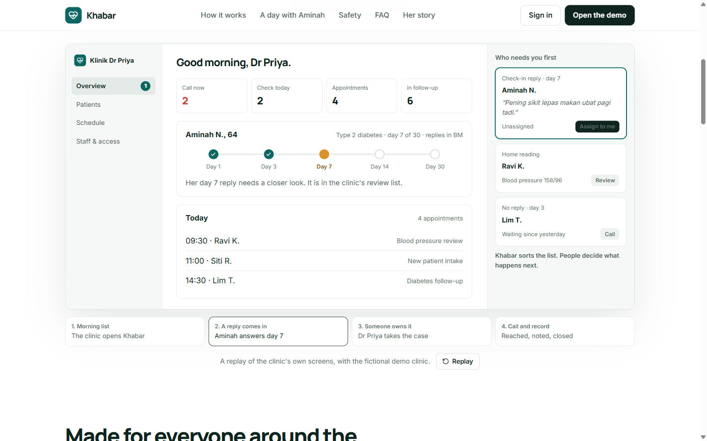
*Further down: who Khabar is for; a grid of channels, each marked Live, Prototype or Not connected; a side-by-side of what a patient types and what the AI reads (`[NAME]`, `[IC]`, `[PHONE]`); "one day with Aminah" from 08:00 to 20:00; the safety rules; an FAQ that states the limits plainly (no automatic staff alerts, not a medical device).*

### 1b. Aminah's story: the storybook film (`/story`)
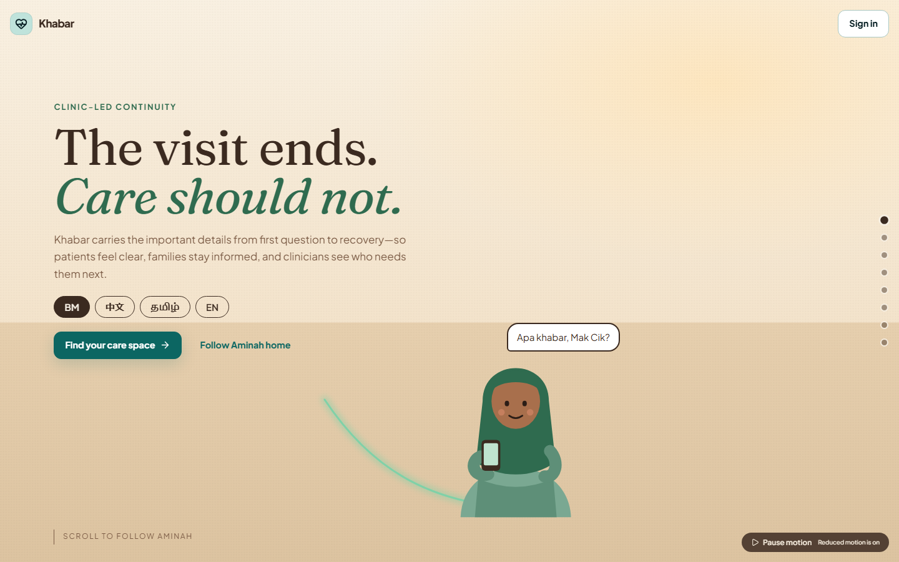
*The film tells Mak Cik Aminah's day as eight scroll-driven acts:*

1. *She leaves the clinic.*
2. *Her prescription turns from the doctor's shorthand into her own language.*
3. *The doctor's notes become a draft, and the safety check stops a dose ten times too high.*
4. *Her 30 days at home.*
5. *Her daughter sees what she chooses to share.*
6. *The whole town the clinic cares for.*
7. *The three safety promises.*
8. *A sky of lights.*

*The language chips switch the greetings between BM, 中文, தமிழ் and English. Readers can reveal each prescription line, reply as Aminah, turn the consent switch, and select or turn the homes in the town. A slim rail on desktop names each act and jumps to it. "Pause motion" (or the device's reduced-motion setting) shows every scene's finished frame, with nothing lost.*

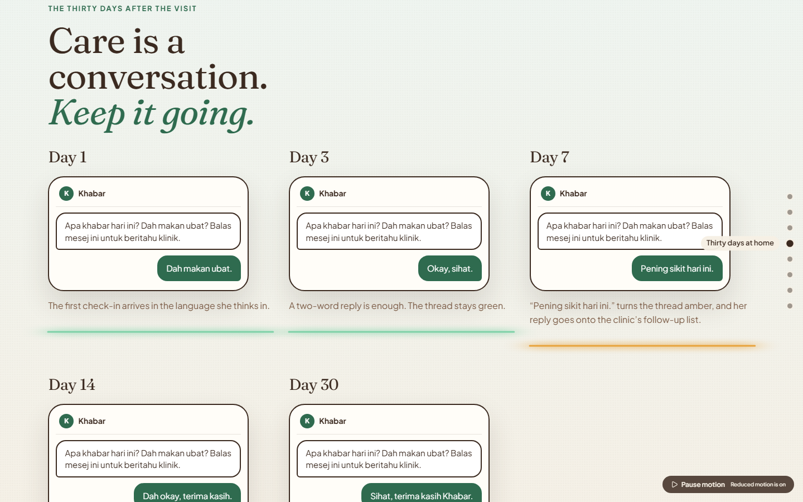
*Every message is the product's own. The check-in and Khabar's answers are copied from `PatientMessages.java`, and a test runs every reply shown through the product's triage word lists. Aminah's prescription lines and the visit's draft and safety finding are generated by the real agents code and checked by another test.*

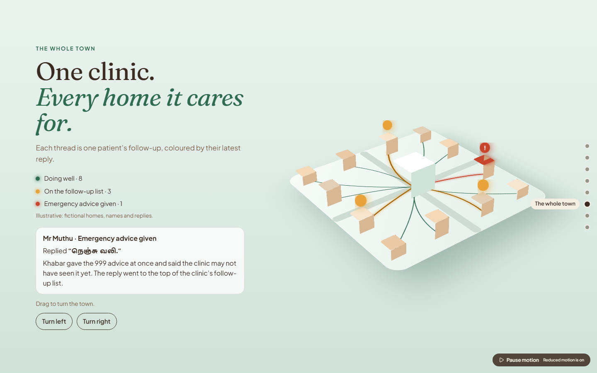
*Twelve fictional homes, labelled "Illustrative". Selecting one shows that patient's reply in their own language and what Khabar did. The town can be turned by dragging, with the Turn left / Turn right buttons, or by tilting a phone after a tap.*

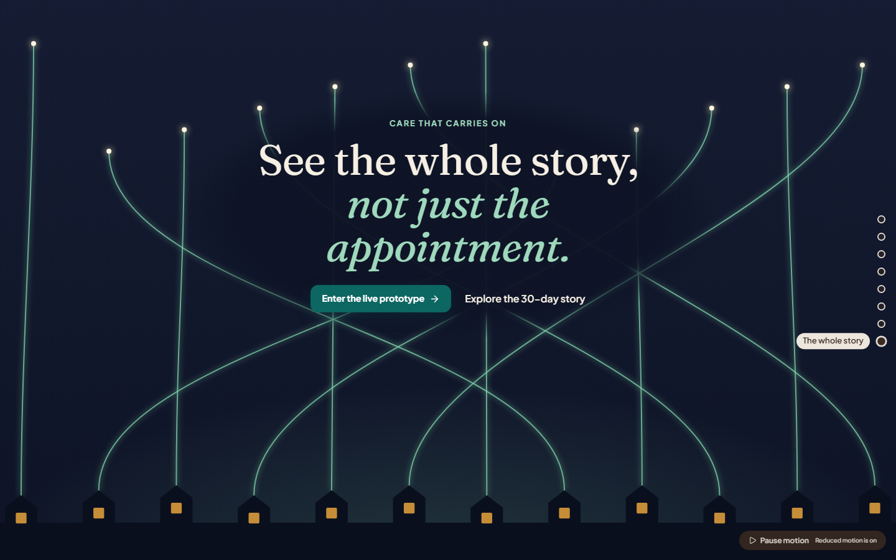

### 2. Sign-in: one door for three roles
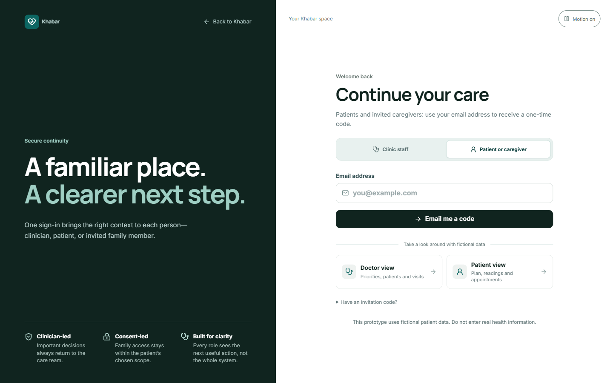
*Clinic staff sign in with email and password; patients and caregivers get a one-time email code (Supabase Auth). Invitation codes link a new sign-in to the right patient record. The two demo buttons are for reviewers.*

*Screens 3, 4, 5 and 7 below were captured before the 18 Oct restyle; the layout and content are the same, with the older serif headings and rounder cards.*

### 3. Doctor home: who needs you first
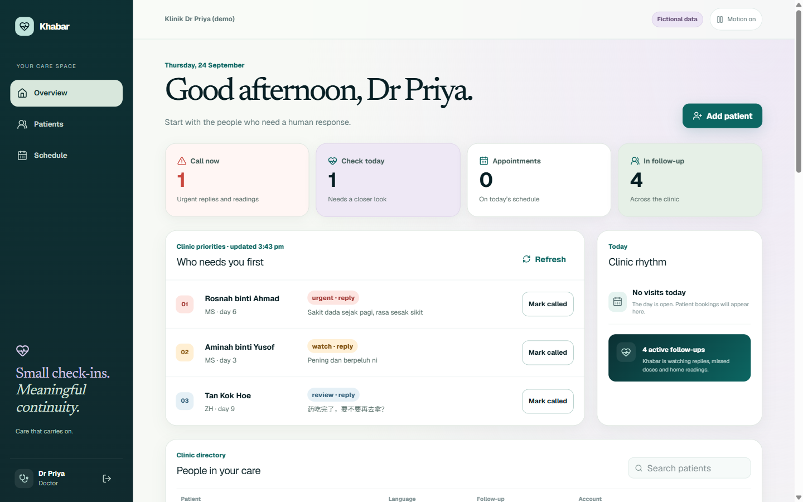
*The clinic's daily list, ranked by urgency: an urgent chest-pain reply in BM ("Sakit dada sejak pagi") comes first, then a dizziness reply, then a Chinese question about a repeat prescription. "Mark called" records that a person followed up.*

### 4. Patient record: the story before the consultation
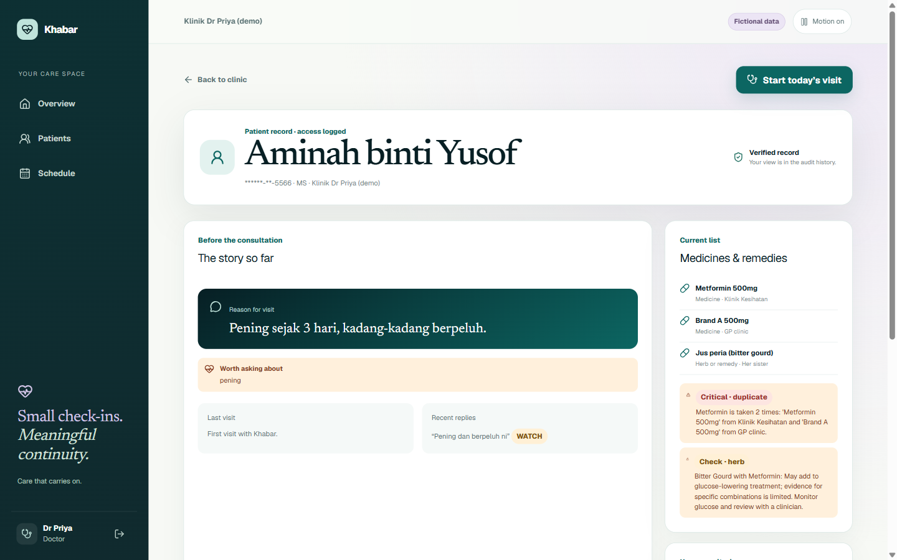
*Opening a record is itself logged ("access logged"). The pre-visit page shows the intake answer in her words, and a **critical duplicate**: metformin from the klinik kesihatan and "Brand A" from the GP are the same drug. Bitter-gourd juice is flagged as a herb check, with its evidence caveat.*

### 5. The visit: a safety gate the doctor cannot skip
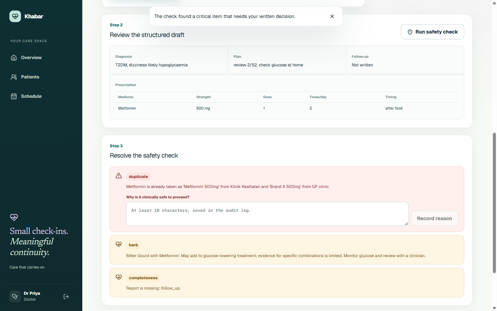
*The doctor's shorthand becomes a structured draft. The safety check then blocks finalising until the doctor writes why the duplicate is safe to proceed with. That reason goes into the audit log. The same rule is enforced again by the API and by a database constraint.*

### 6. Patient home (mobile): one place for the plan
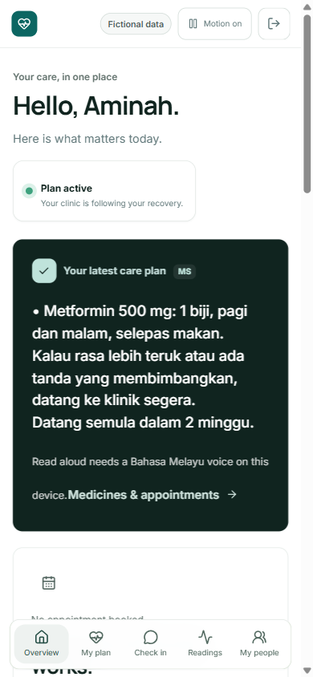

*Aminah's home on a phone: a guided check-in before the appointment, booking, readings, her shared medicine list and her caregivers, with a bottom navigation bar. Anything typed but not sent survives switching sections.*

### 7. A reply that raises a red flag
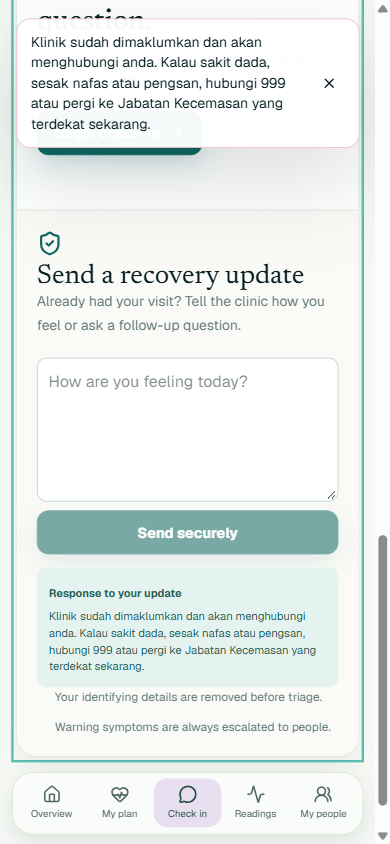

*This scripted example uses a phrase in the current word list. Khabar replies with fixed BM wording (call 999 or go to the nearest emergency department) and adds it to the clinic's list. This is an illustration of the flow, not evidence that Khabar reliably detects emergencies; the recorded word-list score on held-out replies was 2/12.*

---

### New in October 2026

Ideas taken from a sister project's finance copilot and reshaped for a clinic. Each is in the code with tests; none sends anything clinical on its own.

| Feature | What it does | Safeguard |
|---|---|---|
| **Staff alerts and morning briefing** | A clinic links its Telegram staff group with a one-time `/staff` code. When patients wait, the group hears how many, how many are urgent and how many are past the clinic's acknowledgement time, with a link to the call list; optionally a morning briefing (call list, appointments, who is on duty). | Counts only, never a name or a patient's words. Off until a clinic switches it on; off in the `pilot` profile until approved. Every message, sent or only recorded, is in a log. |
| **Plan check** | Before a take-home plan is sent, the API checks every medicine and number in it against the finalised prescription and follow-up date. | A plan that fails is held: not sent and not shown to the patient or caregivers until a doctor releases it with a written reason, which is logged like a safety override. |
| **What the AI saw** | A receipt each time a patient's words, a photo or a recording leave the clinical API for the AI service: exactly what was sent and how many names, IC and phone numbers were replaced. | Shown to the patient and their clinic; reading it is in the access log. |
| **Tamper-evident access log** | "Who viewed my record" entries are sealed into an HMAC hash chain; doctors and admins can verify it, and a daily workflow copies the newest link into [`audit-anchors/`](audit-anchors/). | Editing or deleting any entry breaks the chain; rewriting the whole chain no longer matches an anchor (`node services/scripts/check-audit-anchors.mjs`). |
| **No-reply sequence** | An unanswered check-in gets one gentle re-ask after a day; after two days the patient is on the call list and a caregiver with alert consent sees a notice. | One re-ask only, in the patient's language. |
| **Impact panel** | From the clinic's own records over 7, 30 or 90 days: cases acknowledged in time, cases closed after contact, urgent replies, check-ins answered, duplicates flagged, plans held, median time to acknowledge. | Counts with what they are out of; no estimates or benchmarks. |
| **Case notes and @mentions** | Team notes on a follow-up case; `@Name` puts the note in a colleague's mentions. | Doctors and nurses only; encrypted; never sent to the patient or the AI. |
| **PDPA rights** | Patients download everything held about them and ask for erasure or correction; the clinic decides and records what it did. A breach register walks each incident through containment, assessment, Commissioner notice, notice to people affected, and closure. | Erasure removes identity and sign-in but keeps the clinical record for the legal retention period. |
| **Telegram voice and photos** | A voice note is transcribed and shown back; it becomes a reply only when the patient taps Send. A packet photo is read only after the patient taps Read label; what is read joins the medicine list as "please verify". | Files are not kept; each read leaves an AI receipt. |
| **Patient app in four languages** | Patient and caregiver screens follow the patient's language, with a switcher for BM, EN, 中文 and தமிழ். | A unit test checks every phrase has all three translations. The Chinese and Tamil wording needs a fluent reader's review. |
| **Dose, refill and visit reminders** | A patient can switch on Telegram reminders. At each dose time they get the medicines the doctor prescribed for that time (sahur and berbuka while fasting) with ✅ Taken / ❌ Missed buttons, also answerable in the app; a refill reminder three days before the plan runs out; and the evening before a visit, "I'll come" or "Can't come", which frees the slot. Two missed doses in three days put the patient on the call list. | Off until the patient switches it on; off in the `pilot` profile until the wording is approved. Reminders only repeat the doctor's plan; the Missed reply tells the patient to ask their clinic or pharmacist and gives no advice. Only the patient's own linked chat can answer. |
| **No-show follow-up** | A booked visit with no visit started that day is put on the call list two hours later as "missed appointment", until someone records contact. | Uses only the clinic's own booking and visit records. |
| **Caregiver alerts on Telegram** | A caregiver links their own chat with `/link CG-…` and hears when the patient has gone quiet for two days, reported missed doses, or sent a message that may be urgent. | Only caregivers with alert consent; one line, never the patient's words; each event alerts once. |
| **English glosses for staff** | A reply in BM, 中文 or தமிழ் carries an English machine translation on the call list and patient record. | Shown beside the original, labelled as machine translation, never used for triage. Each one leaves an AI receipt. |
| **Plan check for the patient ("teach-back")** | Up to three questions built from the signed plan (times a day, before or after food, next visit), with the right answer straight after; the clinic sees what to explain again. | Built from the prescription, not by a model; framed as a memory aid, not a test. |
| **End-of-shift handover** | At a chosen hour, the staff chat gets open cases, urgent ones, who owns what and what is unowned; staff can preview or send it now. | Counts and staff names only, never a patient. |
| **Condition pathways** | A doctor puts a patient on a diabetes, high blood pressure or post-operation pathway, with default targets from Malaysian guidelines that the doctor can change, and a review date. The daily check-in then also asks for that pathway's reading. | Targets are the doctor's; Khabar only compares readings with them. |
| **Trends and lab results** | 30 days of blood sugar and blood pressure against the targets (with a table view), dose answers per day, and HbA1c, LDL, eGFR and creatinine against their targets. Each measure says improving, steady or worsening by comparing the last 7 days with the 7 before. | Lab results are for the patient and their doctors only; caregivers see readings and doses. |
| **Follow-up risk score** | Visible points for what went wrong lately (missed doses, rising readings, no reply, missed visit, HbA1c above target, review due, plan check wrong), shown on the call list and in "Who is slipping". The clinic sets the points. | Orders patients only within the same urgency and reason; never moves an urgent reply down. Nurses see the rule, not the values; every read is logged. |
| **Ask Khabar** | A doctor asks "which of my diabetics are slipping?" and gets an answer from the clinic's own follow-up table, with the patients it relied on. | The AI sees coded rows (P1, P2 …) and no names: every clinic patient's name is removed from the question. Read-only. Without a model, Khabar's rules answer. Each patient listed is in their access history; each row sent leaves a receipt with that patient's row only. |
| **Call scripts and visit pre-brief** | Before a call, a nurse gets questions about what the record shows, in English and the patient's language. Before a consultation, the doctor gets "what changed since the last visit" on one screen. | A script ends with the clinic's fixed emergency sentence, never AI wording, and never advises. The pre-brief is built from the record with no AI. |
| **Meal photo check** | A patient sends a photo of a meal (Telegram or app); the AI names the food groups from a fixed list and the patient gets back the clinic's own diet tips for them. | No calories, portions or advice of the AI's own; only doctor-approved tips. Consent first; the photo is not kept. |
| **Easier access** | Voice replies in the app (speak, check the words, send), a simple big-button screen, a "voice first" check-in, a family Telegram group that gets reminders and can tap Taken, and caregivers who can answer doses, write a check-in or book a visit for the patient. | Caregiver actions need the patient's alert consent and are recorded as the caregiver's. Text typed in the family group never reaches the clinic. |
| **Operations** | A workload board with a balance button, a printable monthly outcomes report, a CSV patient import with a row-by-row preview, and a public pricing page with a value calculator. | The report has counts only, no projections and no names. The calculator uses the clinic's own numbers and says so. |

## 4. What Makes It Different

| Feature | What's new, or the twist |
|---|---|
| **After the visit is the product** | Most clinic AI ends when the patient leaves. Khabar's value is days 1–30. |
| **Four-language follow-up** | Summaries and reply handling support BM, English, Chinese and Tamil, including Manglish replies like *"pening sikit"*. The prototype classifier has not been validated for emergency detection. |
| **Cautious reply routing** | Word lists route replies for clinic attention; an optional model can only raise the level. Word lists scored 22/22 on tuned examples but 2/12 on held-out replies, so these labels are not a reliable emergency screen. Human review and the fixed precautionary 999 message remain essential. |
| **Patients only hear approved words** | Replies come from fixed sources: precautionary 999 wording, answers the clinic approved, or an acknowledgement. The AI does not generate patient advice. |
| **"Everything I take," across clinics and cultures** | Cross-checks medicines from *other* clinics, local brand names, and **traditional remedies** (jamu, herbs, TCM) that patients rarely mention. |
| **Safety checks from data, not AI opinion** | Interactions come from **DDInter 2.0**, with written rules for allergies, doses, duplicates and herbs. The AI structures notes; it does not judge safety. |
| **A gate enforced three times** | A critical finding is blocked in the UI, the API **and** a database rule, so a bug in one layer can't let it through. |
| **Ramadan fasting mode** | Timings move to sahur and berbuka, and check-ins ask about low-blood-sugar symptoms. Doses stay the doctor's decision. |
| **"Who viewed my record"** | Patients can see who opened their data, which clinic software rarely offers. |
| **De-identified patient graph** | Neo4j holds each patient's medicines, herbs, conditions and visits under a random ID only. A test proves the patient's name, IC and phone number cannot reach it. |

**Comparison with the solutions named in Section 1**

| | CliniFlow AI | Memora Health | PULIH (AstraZeneca) | **Khabar** |
|---|---|---|---|---|
| Clinic workflow (intake → report → safety) | ✅ | — | — | ✅ |
| Follow-up after the visit | One WhatsApp message | ✅ SMS, US | Medication reminders | ✅ 30 days, two-way |
| BM / Chinese / Tamil | — | — | — | ✅ |
| Prototype reply routing to a clinic queue | — | ✅ | — | ✅; emergency detection and staff alerts are not validated/implemented |
| Traditional-medicine and other-clinic check | — | — | — | ✅ |
| Ramadan mode | — | — | — | ✅ |
| Patient-visible access log | — | — | — | ✅ |

*— = not mentioned in the public material we reviewed.*

---

## 5. Technical Architecture & Feasibility

### Tech stack

| Layer | Choice | Why we chose it | Constraints we expect |
|---|---|---|---|
| **Frontend** | **Next.js 16**, React 19, TypeScript. A web app that installs on phones. The landing page is mostly server-rendered, with two small client components; the `/story` film is built with **GSAP ScrollTrigger** and code-drawn SVG. | One codebase for doctor, patient and caregiver. Reviewers open a link, with nothing to install. The camera works in the browser for packet photos. GSAP keeps normal scrolling (no scroll-jacking). | No push notifications without a native app, so reminders go through Telegram instead. The film's painted backgrounds are not made yet; each act shows a gradient placeholder until they are. |
| **Clinical API** | **Spring Boot 3.3** (Java 21) | Strong typing and structure for clinical data, access checks and encryption. It is the only service that holds the encryption key and the only one that touches the database. | A steep learning curve for a first backend. Cold starts on serverless hosting (~15 s after idle). |
| **AI service** | **FastAPI + LangGraph** (Python) | Agents with explicit control flow: intake, report, evaluator, triage, summary, packet reader. Python has the best AI libraries. | A second language and service to deploy and secure (it only accepts calls signed with an internal service key). |
| **Database and sign-in** | **Supabase** (Postgres + Auth) | Free tier; built-in email one-time codes and passwords; managed Postgres. | Free projects pause when idle. Its built-in email only reaches team members and its links are meant for local development, so patient codes go through a custom SMTP sender (currently a Gmail account, with Gmail's daily sending limit). The connection pool is small, so the API uses the transaction pooler. |
| **Patient graph** | **Neo4j AuraDB** (Free) | Multi-step questions ("which drug, from which clinic, clashes with which herb") are natural in a graph. Stores no names. | The free instance pauses when idle, and its password cannot be changed, so a leak means recreating it. The graph can be rebuilt from Postgres in one call. |
| **LLM** | **Google Gemini** (Flash), swappable in one setting | Low cost, multilingual, and it can read photos, so one provider covers text and packet images. | On the free tier Google may use the data, which is acceptable only because every record here is fictional. The final model is still to be chosen by the planted-error test. |
| **Transcription** | **Groq Whisper large-v3-turbo** | About US$0.04 per hour of audio; supports Malay and Tamil. | First measurement (28 Sep, one speaker, three fictional notes): 2 of 3 drug names right, the dosage-form word ("tablet", "capsule") wrong every time, and once a dose misheard nine-fold. Neither a different prompt nor the full `large-v3` model did better. The doctor reviews every transcript; typed shorthand stays the primary input. More speakers and languages are still to be tested. |
| **Messaging** | **Telegram Bot API** (replaced WhatsApp on 28 Sep) | A bot needs no business approval or message templates and has no test-recipient limit, so the full two-way loop works the same day. Patients link by sharing their own Telegram-verified phone number, which doubles as consent. Every webhook delivery must carry our secret token. | Telegram is less used than WhatsApp in Malaysia, especially by older adults. Bot chats are not end-to-end encrypted, so fictional data only. Patients who have not linked the bot get nothing on their phone. Without a bot token, messages go to a local outbox. |
| **Drug data** | **DDInter 2.0** subset + our own brand-name and herb tables | Free, peer-reviewed interaction data (70 pairs cover the demo medicines), with a reproducible import script. | Non-commercial licence (CC BY-NC-SA 4.0). Brand names are mapped by hand, and the herb list needs a pharmacist's review. Missing data is never treated as "safe". |
| **IoT (stretch)** | **Favoriot** | A Malaysian IoT platform with a REST API and per-device secrets. | Its 25 Sep 2026 pricing page lists a limited lifetime free plan (1 device, 500 daily data points, 1-month retention); the separate signup page shows older conflicting limits. The demo uses simulated readings until an account and live test confirm availability. See [`UNDONE_WORK.md`](UNDONE_WORK.md) §2.2. |
| **Hosting** | **Vercel**: `khabar-landing` for the web app; `khabar-api` in Singapore (`sin1`) running the API as a container and the agents as a Python service | Free tier, low latency from Malaysia, one place to deploy. A push to `main` that changes the web app is checked (lint, types) and deployed automatically by GitHub Actions. | Serverless cold starts, and the free Supabase and AuraDB tiers pause when idle. Before a live demo we warm everything up or move the API to an always-on host. |

### System architecture diagram
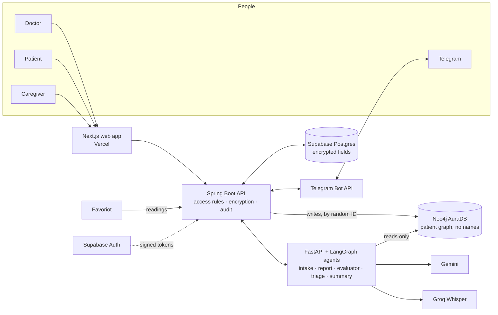

**Rules the architecture enforces**
1. **The agents never see the patient's identity.** The API removes the patient's registered name and any IC or phone number before text reaches the AI, and the agents never touch Postgres. Other people's names typed in free text are not detected, so the screens ask patients not to type names.
2. **Only the API holds the encryption key.** IC, phone, notes, replies, summaries, intake chats, medication lists and booking reasons are encrypted in the database.
3. **Rules and data first, AI second.** Safety checks use DDInter and written rules wherever they exist.
4. **Critical findings are blocked three times:** in the UI, in the API, and by a database rule.
5. **Every token is checked.** Real Supabase sign-ins (ES256, against the project's published keys) and demo tokens (HS256) are each verified only against their own key, and must be unexpired and issued for this app.

### Build plan & scope
One builder, so the scope is tiered. **Tier 1 alone is a complete, demonstrable product.** If time runs short, features are dropped from the bottom up. The full day-by-day schedule and demo script are in [plan.md](plan.md).

| Tier | Scope | Status (28 Sep) |
|---|---|---|
| **Tier 1: committed** | Sign-in and access rules · intake chat and pre-visit page · structured report draft from clinician notes · safety checks with the three-layer gate · multilingual summary · 30-day check-ins · prototype reply routing · clinic call list · de-identification · 30 fictional patients · demo clock | ✅ Built; the full core story was rehearsed on the live site with real accounts on 28 Sep ([record](docs/DEMO_RUN_2026-09-28_DEPLOYED.md)) |
| **Tier 2: planned** | Packet photo · caregiver access · Ramadan mode · field encryption · "who viewed my record" · self-booking · Neo4j graph | ✅ Built. Packet photos passed their first real Gemini test on the live site (28 Sep, one fictional packet); real-world photo quality is untested. |
| **Tier 3: stretch** | Speaking instead of typing in the visit · Favoriot readings · voice-note summaries · learning each doctor's writing style | Speech-to-text is live (28 Sep) and spoken notes are structured like typed ones, but transcription errors on drug and dosage-form words mean the doctor reviews every transcript. Favoriot is built, with simulated readings. Voice notes: an in-app read-aloud of the approved summary is in review; audio over Telegram is not built. Writing style is **not built** and first to drop. |

**What's live, and what's left**

| Part | Done | Still to do |
|---|---|---|
| Sign-in and access | Doctor and patient access rules; caregiver `SUMMARY` is limited to the approved summary, while `SUMMARY_AND_ALERTS` permits shared patient details, medicines and readings; revoking consent blocks the next API request. On 27 Sep, real doctor, patient and caregiver accounts signed in on the live site, and revoking a caregiver blocked their open session on refresh. Patient and caregiver email codes go through a custom SMTP sender. | Cross-clinic and cross-patient denial checked on the deployment (covered by automated tests locally) |
| Visit and safety | Notes or speech → structured draft; the ten-mistake planted-error set is a test, and all ten are caught | Pharmacist review of dose limits and herb evidence |
| Follow-up | Check-ins, prototype four-language reply routing, approved-words-only replies, missed doses, home readings, the ranked call list | Validate triage on clinician-authored held-out replies; live Telegram loop with a fictional patient; a real Favoriot device |
| Patient graph | Live on AuraDB, read back by random ID only; re-synced on 28 Sep (32 fictional patients) | The free instance pauses when idle and graph writes made meanwhile are dropped, so resume it and re-sync before a demo (a warm-up script is in review). Verify Aminah's `Condition` nodes after a demo reset. |
| Evidence | Automated tests and bug bash (below) | Clinician-authored triage evaluation; the transcription test; the 5-person understanding pilot |

---

## 6. Evidence it works

- **Verification (28 Sep):** hosted CI on `main` ([run 36334856328](https://github.com/tanhongsheng050204-code/KHABAR-HEALTHCARE/actions/runs/36334856328)) passed the API tests (including PostgreSQL 16 migrations V1–V6 and a backup/restore rehearsal), the agent tests, and the web lint, type check and production build. The full API suite also passes locally with the JVM set to UTC (240 run, 0 failures, 1 optional PostgreSQL test skipped), after fixing three tests that depended on the machine's time zone. The public API and agents both reported healthy after the 28 Sep deployment.
- **Deployed rehearsal with real accounts (28 Sep):** the full core story ran on the live site with real Supabase doctor and patient accounts, from guided intake to the patient's urgent Malay reply at the top of the call list. The critical duplicate-medicine gate blocked finalisation until a reason was written. It also found five issues, including a paused AuraDB instance; see [the run record](docs/DEMO_RUN_2026-09-28_DEPLOYED.md).
- **Bug bash (23 Sep):** 11 defects found and fixed, including one patient-safety issue: a reply confirmation that could be empty when triage was down now always includes 999 advice. See [docs/BUG_BASH_2026-09-23.md](docs/BUG_BASH_2026-09-23.md).
- **Deployed rehearsal (23 Sep):** pre-visit → draft → safety review → finalise → summary → follow-up reply → call list, run on the public URLs with demo sign-in.
- **Local rehearsal (25 Sep):** guided intake → pre-visit report → doctor visit and duplicate-safety gate → final summary → patient follow-up reply → doctor call list, plus caregiver access/revocation and agent-outage fallback, all exercised with fictional data. It did not verify the current public deployment, real sign-in, or graph/provider readiness; see [the local run record](docs/DEMO_RUN_2026-09-25_LOCAL.md).
- **Privacy test:** a test proves that the patient's name, IC number and phone number cannot reach the Neo4j graph, and the live AuraDB instance was checked directly. The graph stores structured facts (conditions, medicines, matched symptom words), not free-text answers.
- **Ledger look and new landing page (18 Oct):** 22 new browser tests cover the landing page (one-click demo links, the replay by click, autoplay and reduced motion, the day timeline by click and arrow keys, honest connector statuses, the FAQ) with zero axe violations, and the film's 200+ tests now run against `/story`. An axe pass over the signed-in doctor and patient homes and the sign-in page found one low-contrast note on the dark care-plan card, which was fixed.
- **Storybook film (1 Oct, now at `/story`):**
  - **Tests:** 204 browser tests (Playwright, at 1440×900 and on a 390 px phone) cover:
    - every act's finished frame and every interaction, by mouse, touch and keyboard;
    - zero automated accessibility (axe) violations, with motion on and off;
    - no sideways scroll at 320 px in Tamil;
    - Pause stopping all motion.
  - **Performance:** Lighthouse mobile scored 94–95, with no layout shift (CLS 0). LCP is 2.8 s (simulated), against a 2.5 s target.
  - **Truthfulness:** tests tie its patient-facing words to the product's code.
  - **Details:** [the review record](docs/LANDING_FILM_SLICE_REVIEW.md).
- **Planned comprehension check:** a draft five-person summary-understanding protocol is in [`docs/PATIENT_UNDERSTANDING_TEST_DRAFT.md`](docs/PATIENT_UNDERSTANDING_TEST_DRAFT.md). It is not approved or run; recruitment and results remain open. Any result will be reported as a small usability signal, not proof of clinical impact.

---

## 7. Run it yourself

**Easiest:** open [khabar-landing-six.vercel.app](https://khabar-landing-six.vercel.app) and press **Open the demo clinic** (or **Sign in**, then **Doctor view** or **Patient view**). The first load may take ~15 s while the API wakes up.

**Locally** (Java 21, Python 3.11+, Node 20+; no accounts needed):

```powershell
# API with 30 fictional patients and a clock you can fast-forward
cd services/api;    .\mvnw.cmd spring-boot:run "-Dspring-boot.run.profiles=local"
# Agents service
cd services/agents; .\.venv\Scripts\python.exe -m uvicorn main:app --port 8000
# Web app, then open http://localhost:3000
cd web;             npm install; npm run dev
```

Details, environment variables and tests: [services/README.md](services/README.md). The live API is browsable at [/docs](https://khabar-api.vercel.app/docs).

| Folder | What's in it |
|---|---|
| [web/](web/) | The Next.js app (deployed). The landing page is in [web/components/site/](web/components/site/), the `/story` film in [web/components/film/](web/components/film/), and their browser tests in [web/e2e/](web/e2e/) |
| [services/api/](services/api/) | Spring Boot clinical API |
| [services/agents/](services/agents/) | FastAPI + LangGraph agents, DDInter subset and import script |
| [docs/](docs/) | Design notes, the daily [EXPLAIN.md](docs/EXPLAIN.md), bug bash, demo checklist, pitch scripts, earlier static screens |
| [plan.md](plan.md) · [UNDONE_WORK.md](UNDONE_WORK.md) · [FUTURE_PLAN.md](FUTURE_PLAN.md) | The plan, open work, and the product direction |

---

## 8. Credits & Declarations

- **Inspiration:** CliniFlow AI (UM Hackathon 2026 champion), for the clinic workflow and the safety-gate pattern. Khabar is a practice build ahead of SDC Hackathon 2026 and is **not** a competition entry.
- **Drug interaction data:** DDInter 2.0 (*Nucleic Acids Research*, 2025), licensed **CC BY-NC-SA 4.0**. The checker uses a generated subset for the demo medicines; see [import_ddinter.py](services/agents/scripts/import_ddinter.py) and [ddinter_interactions.json](services/agents/data/ddinter_interactions.json). Source: [DDInter downloads](https://ddinter.scbdd.com/download/). The non-commercial licence limits commercial use.
- **External services:** Google Gemini, Groq, Telegram Bot API, Supabase, Neo4j AuraDB, Vercel, Favoriot.
- **AI tools used in development:** Claude Code (Anthropic) for planning, research, the backend services and the web app; Google Antigravity for the earlier static screens in `docs/`. All AI-written code is reviewed, and explained in plain language in [docs/EXPLAIN.md](docs/EXPLAIN.md).
- **Data:** every patient in this repository and in the live demo is fictional. No real patient data is used or stored. Please don't enter real health information into the demo.
- **Not a medical device:** Khabar does not diagnose or treat. Every clinical decision stays with a clinician.

### Sources
[NHMS 2023 (CodeBlue)](https://codeblue.galencentre.org/2024/05/over-two-million-adults-in-malaysia-live-with-three-ncds-nhms-2023/) · [Malaysian health literacy](https://www.ncbi.nlm.nih.gov/pmc/articles/PMC8197907/) · [Medication adherence in Malaysia](https://pubmed.ncbi.nlm.nih.gov/42584433/) · [Polypharmacy in older Malaysians](https://journals.plos.org/plosone/article?id=10.1371%2Fjournal.pone.0173466) · [Traditional medicine & drug problems (meta-analysis)](https://pmc.ncbi.nlm.nih.gov/articles/PMC7996557/) · [Ramadan & diabetes in Malaysia](https://www.ncbi.nlm.nih.gov/pmc/articles/PMC3253336/) · [UNDP: older persons in Malaysia](https://www.undp.org/malaysia/blog/navigating-future-care-older-persons-malaysia-2040-community-support-technological-integration) · [Doctor workload (Focus Malaysia)](https://focusmalaysia.my/malaysias-healthcare-system-is-under-strain-and-reforms-cannot-wait/) · [AI vs professional translation of discharge instructions](https://pubmed.ncbi.nlm.nih.gov/40960827/) · [Bessemer: State of Health AI 2026](https://www.bvp.com/atlas/state-of-health-ai-2026) · [Memora Health](https://www.memorahealth.com/) · [PULIH by AstraZeneca](https://play.google.com/store/apps/details?id=com.astrazeneca.pulih&hl=en) · [DDInter 2.0](https://academic.oup.com/nar/article/53/D1/D1356/7740584)
